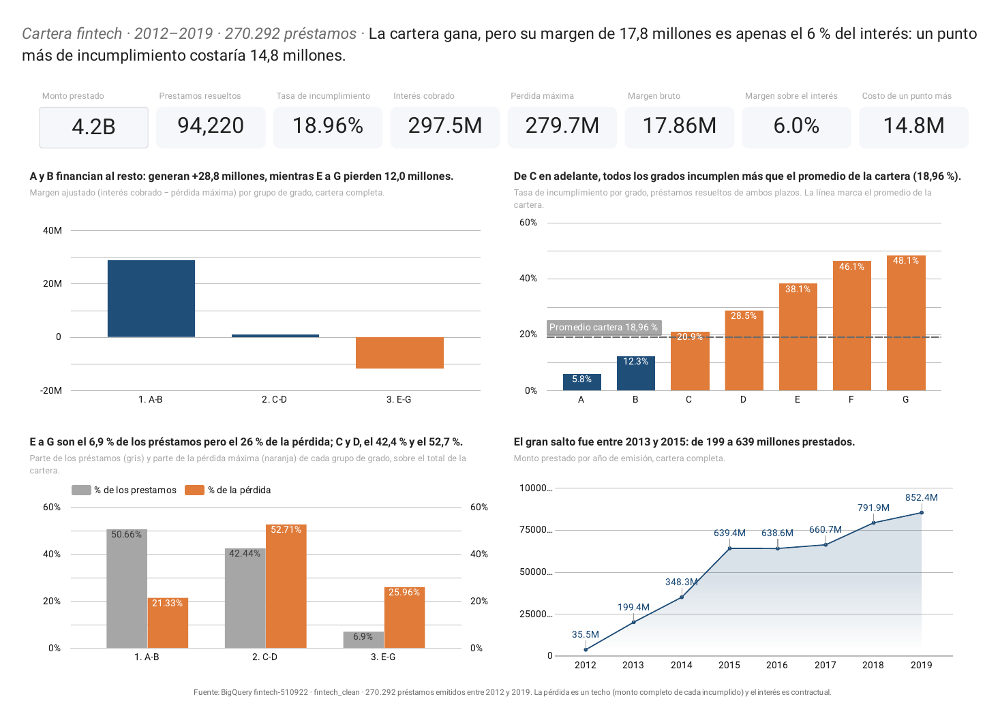
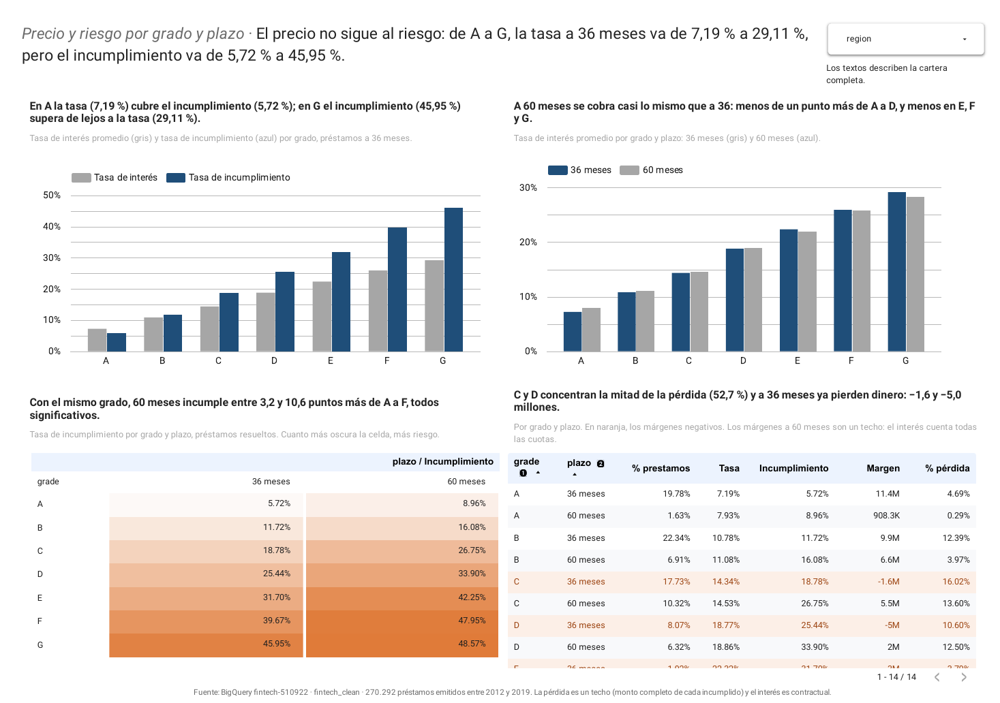
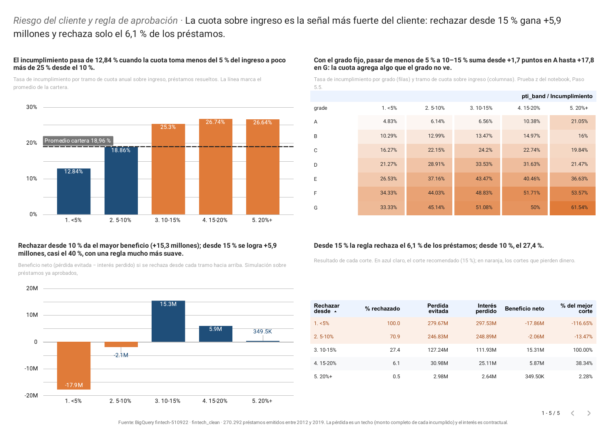
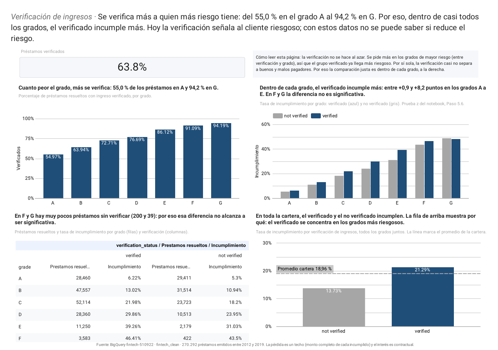
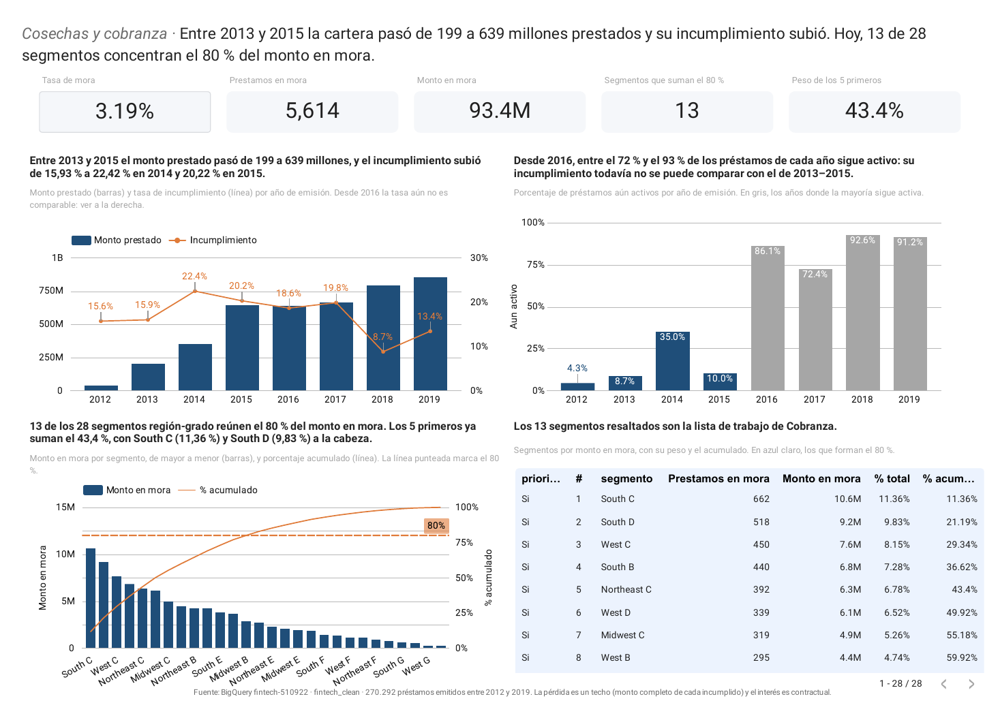

# Fintech Loan Portfolio: From Data to Credit Decisions

**An end-to-end analytics project** on 270,292 personal loans: raw data validated in Python, cleaned into a relational model in BigQuery SQL, tested with inferential statistics, and shared through a five-page dashboard in Data Studio (formerly Looker Studio). The question behind it: *does this lending portfolio make money, and where should the business act to lose less?*


## 📌 Project Overview

A fintech lends personal loans graded A (lowest risk) to G (highest risk), at 36 or 60 months. This project measures how much the portfolio earns and loses, finds which segments concentrate the risk, checks which signals hold within the same grade, simulates an approval rule, and points collections to where the money in delinquency sits.

| Goal | Business question |
|---|---|
| Reduce losses | P1. How much do we lend, how much defaults and how much do we lose? |
| Reduce losses | P2. Which customer profile defaults the most? |
| Reduce losses | P3. Which approval rule would reduce losses without giving up too much interest? |
| Increase revenue | P4. Does the interest rate of each grade and term pay for its risk? |
| Increase revenue | P5. Is the portfolio growing while keeping its quality? |
| Reduce costs | P6. Does verifying income reduce default within the same grade? |
| Reduce costs | P7. Where is the money in delinquency concentrated? |
| Reduce losses | P8. Which variables are really associated with default, and do they hold within the same grade? |

## 🗂️ Data Source

Google's public BigQuery dataset `cloud-training-demos.fintech`. Three tables are used:

- `loan` — 270,299 loans issued 2012–2019: amount, rate, term, installment, grade, purpose, status
- `customer` — one row per borrower: income, employment length, home ownership, income verification, existing debt
- `state_region` — US states with their subregion and region

After cleaning, 270,292 loans remain. The raw CSVs are not included in this repository (see *How to Reproduce*).

## 🔎 Methodology

1. **Load and explore (Python)** — reusable diagnostic functions: structure, nulls, duplicates, inconsistent categories, key integrity and IQR outliers.
2. **Quality checks (BigQuery SQL)** — every issue confirmed in SQL before deciding how to fix it.
3. **Clean relational model (BigQuery SQL)** — `dim_region`, `dim_customer`, `fact_loan` and the analysis view `view_loan`.
4. **KPIs** — lending, default rate, interest, maximum loss, margin and the cost of one extra point of default, by grade and term.
5. **Risk segments and statistical tests** — chi-square with Cramér's V as a filter (V < 0.10 treated as independent), point-biserial correlation, Spearman for collinearity, and two-proportion z-tests within the same grade.
6. **Approval-rule simulation** — net benefit of rejecting loans above each payment-to-income cut-off.
7. **Vintage analysis** — growth and default by issue year, and how much of each year is still active.
8. **Collections focus** — Pareto of the delinquent amount by region × grade.
9. **Dashboard (Data Studio, formerly Looker Studio)** — two BigQuery views feed the cumulative results; everything else aggregates `view_loan` live.

## 📊 Key Findings

**1. The portfolio is profitable, but barely.** Of $4.17B lent, 94,220 loans have a final outcome and 18.96% of them defaulted. Interest collected ($297.5M) only just covers the maximum loss ($279.7M): a $17.86M margin, 6% of interest. One extra point of default would cost $14.8M.

**2. Price does not follow risk.** At 36 months, the interest rate goes from 7.19% (A) to 29.11% (G) while default goes from 5.72% to 45.95%. Grades A–B earn +$28.8M and E–G lose $12.0M. A 60-month term charges less than one point more than 36 months, yet defaults 3.2 to 10.6 points more in grades A–F (all significant).

**3. Payment-to-income is the strongest customer signal.** Default goes from 12.84% when the installment takes less than 5% of income to just over 25% from 10% upwards. With the grade fixed, moving from under 5% to 10–15% of income adds +1.7 points of default in A up to +17.8 in G. Rejecting from 15% would add +$5.9M while rejecting only 6.1% of loans; the 10% cut-off maximizes the benefit (+$15.3M) but rejects 27.4%. Employment length, home ownership, income, existing debt, purpose and region show no relationship (V < 0.10).

**4. Income verification marks risk; it does not show that it reduces it.** Verification rises from 55.0% of loans in A to 94.2% in G, and within grades A–E verified borrowers default 0.9 to 8.2 points more. The data cannot separate cause from selection; a controlled test would.

**5. Growth came with more risk, and delinquency is concentrated.** Lending grew from $199M (2013) to $639M (2015) while default rose from 15.93% to 22.42% (2014). Today 13 of 28 region-grade segments hold 80% of the $93.4M in delinquency, and the top five hold 43.4%.

> **Limitations:** loss is an upper bound (the full funded amount of each default, no recoveries) and interest is contractual; the approval rule is simulated only on loans that were already approved; vintages from 2016 onward are still mostly active; the tests compare two variables at a time.

## 📈 Dashboard

Built in **Data Studio**, Google's free BI tool, called **Looker Studio** until April 2026 (same product, new name).

**[▶ Open the interactive dashboard](https://datastudio.google.com/reporting/bcfc4c3a-03a6-4b3b-af2e-5fca35f0f145)** · [PDF version](dashboard/fintech_dashboard.pdf)

| Page | What it shows |
|---|---|
| 1. Portfolio overview | Eight KPIs, margin and default by grade, share of loans vs. share of loss, lending by year |
| 2. Pricing and risk | Rate vs. default by grade and term, with a region filter |
| 3. Approval rule | Default by payment-to-income band and the simulated benefit of each cut-off |
| 4. Income verification | Who gets verified and how verified borrowers compare within each grade |
| 5. Vintages and collections | Growth and default by year, and the collections Pareto |







## 🛠️ Skills Applied

- **Python** — pandas, reusable data-quality functions, IQR outlier detection, matplotlib and seaborn charts
- **SQL (BigQuery)** — CTEs, window functions (`SUM() OVER`, `LAG`, named windows, `RANK`), dimensional modeling, views
- **Statistics** — chi-square and its assumptions, Cramér's V, point-biserial, Spearman, two-proportion z-tests with confidence intervals, statistical vs. practical significance
- **BI** — Data Studio (Looker Studio): calculated fields, conditional formatting, reference lines, pivot heatmaps, combo and Pareto charts
- **Business analysis** — KPI design, risk segmentation, decision simulation in money terms
- **Version control** — Git and GitHub

## 🧰 Tech Stack

Python (pandas, numpy, matplotlib, seaborn, scipy, statsmodels) · Google BigQuery · Data Studio (Looker Studio) · Git

## 📁 Repository Structure

```
├── notebook/
│   └── fintech_loan.ipynb          # Full analysis, Steps 1–9 (Python + BigQuery SQL)
├── dashboard/
│   ├── fintech_dashboard.pdf       # Static copy of the five dashboard pages
│   └── screenshots/                # Dashboard preview images
├── requirements.txt                # Python dependencies
├── .gitignore
└── README.md
```

## ▶️ How to Reproduce

1. **Clone the repository**
   ```bash
   git clone https://github.com/CRojas-2/fintech-loan-portfolio-analysis.git
   cd fintech-loan-portfolio-analysis
   ```
2. **Install the dependencies** (Python 3.10 or newer)
   ```bash
   pip install -r requirements.txt
   ```
3. **Set up Google Cloud**: create a project, enable BigQuery, create the datasets `fintech_raw` and `fintech_clean`, and authenticate with `gcloud auth application-default login`.
4. **Get the data**: export the tables `loan`, `customer` and `state_region` from `cloud-training-demos.fintech` as CSV and save them in `data/raw/`.
5. **Point the notebook to your project**: replace `fintech-510922` with your project ID (Find and Replace in the notebook) and run it top to bottom. Step 1 uploads the CSVs to `fintech_raw`; Step 9 creates the two dashboard views.
6. **Rebuild the dashboard (optional)**: in Data Studio (datastudio.google.com, formerly Looker Studio), connect `view_loan`, `dash_regla_aprobacion` and `dash_cobranza` from your `fintech_clean` dataset.

> Code comments and column names in the SQL are in Spanish; the notebook narrative is in English.

## 📬 Contact

**Camilo Rojas** — [LinkedIn](https://www.linkedin.com/in/camilo-andres-rojas-rojas) — [camilo35546@gmail.com](mailto:camilo35546@gmail.com)
